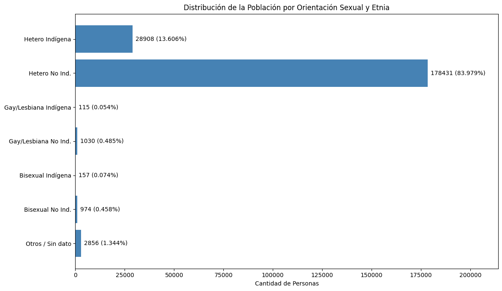
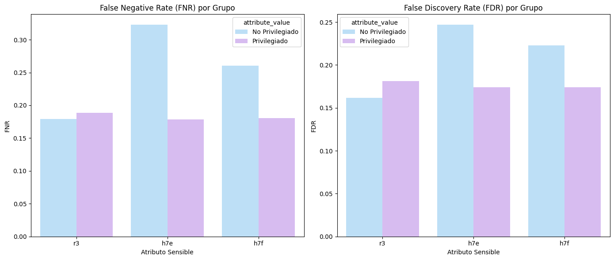
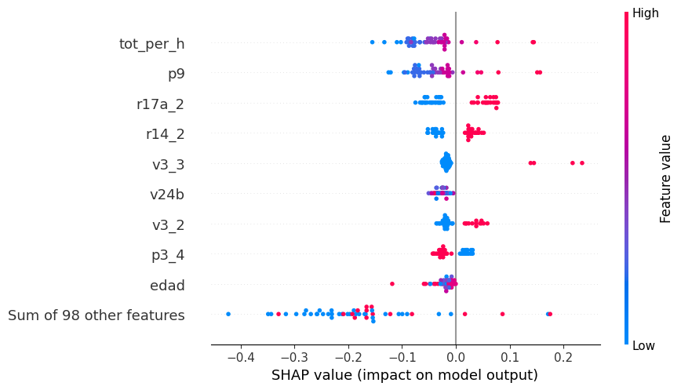
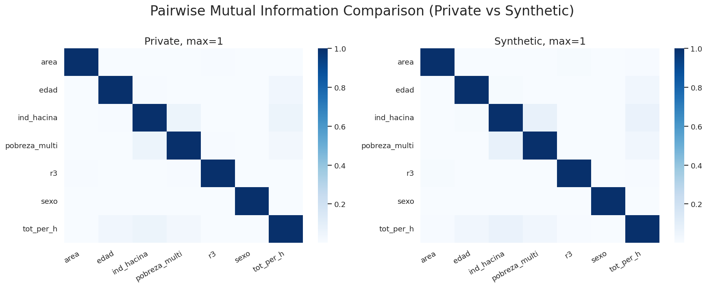

## Introducción y Relevancia del Problema

La elección del dataset de la encuesta CASEN 2024 radica en que permite estudiar las condiciones de vida en los hogares en Chile, a escala nacional, y observar desigualdades que no siempre se pueden ver en estudios generales. Contiene información sobre pobreza multidimensional, vivienda, composición del hogar y características demográficas. Su análisis es relevante para las políticas públicas, en especial para orientar recursos y evaluar necesidades sociales.
Aún así, los datos no nos dicen todo. Aspectos como las decisiones que se realizan para manejar estos datos, como qué variables utilizar, cómo representar a distintos grupos, qué modelos construir y qué información publicar pueden beneficiar o perjudicar a distintas personas.
Por esto, abordamos la encuesta CASEN 2024 desde una perspectiva de activismo de datos, usando la evidencia para hacer visibles las desigualdades que pueden haber y realizar un tratamiento responsable de la información.

## Desarrollo de los talleres:

### Taller 1: ¿A quiénes representan los datos?

Exploramos las variables del dataset y analizamos la representación de distintos grupos, considerando características como pertenencia indígena, orientación sexual e identidad de género. Logramos observar desbalance entre categorías y discutimos sus posibles consecuencias. Entre ellas, encontramos que cuando algunos grupos aparecen con poca frecuencia, los análisis y modelos pueden describir peor sus realidades. También identificamos la importancia de revisar los datos y sus categorías para poder sacar conclusiones.

### Taller 2: ¿Un modelo preciso es siempre justo?

Entrenamos un árbol de decisión para predecir la pobreza multidimensional y evaluamos su desempeño con métricas de clasificación y equidad. Al comparar grupos en cuanto a variables relacionadas con discapacidad, identificamos diferencias importantes en los errores del modelo. Además, los falsos negativos fueron superiores en personas pobres siendo clasificadas como no pobres.
Por otro lado, utilizamos una técnica de mitigación de sesgos. En nuestro análisis, las diferencias entre grupos disminuyeron, pero también disminuyó levemente la exactitud general. Esto demuestra que evaluar solamente el accuracy no es suficiente cuando las predicciones podrían influir en el acceso a ayudas sociales.

### Taller 3: ¿Podemos explicar las decisiones de la IA?

Utilizamos LIME para examinar como un modelo de lenguaje clasificaba comentarios hipotéticos sobre beneficios sociales. Encontramos casos en que expresiones de agradecimiento acompañadas de críticas eran clasificadas como neutras, lo que podría llevar a que problemas relevantes de las experiencias de las personas no sean escuchados.
Además, aplicamos SHAP a un modelo de random forest relacionado con pobreza multidimensional. Esto nos permitió entender qué variables influían en sus predicciones. Explicaciones como estas ayudan a auditar modelos, pero aún así no reemplazan la revisión humana, ni aseguran relaciones causales.

### Taller 4: ¿Cómo proteger la privacidad sin perder utilidad en la información?

Revisamos la encuesta desde un enfoque de derechos humanos y la regulación chilena sobre protección de datos. Luego generamos datos sintéticos con DataSynthesizer, usando siete variables: pobreza multidimensional, sexo, edad, integrantes del hogar, área, pertenencia indígena y hacinamiento. Elegimos el modo correlated_attribute para intentar conservar algunas distribuciones y relaciones estadísticas.
Al comparar los datos originales con los sintéticos mediante ModelInspector, pudimos observar distribuciones bastante similares en variablesc como sexo, área y pertenencia indígena. Además, se mantuvieron algunas relaciones, como la de índice de hacinamiento con pobreza multidimensional. Aún así, hubieron diferencias en categorías menos frecuentes y algunas variaciones en la proporción de pobreza.

## Visualizaciones Representativas de los Talleres

Las siguientes cuatro visualizaciones provienen directamente de los talleres desarrollados durante el semestre y se enlazan en un mismo hilo conductor en torno a la pobreza multidimensional y la protección de grupos vulnerables en CASEN 2024.

---

### 1. Representación y desbalance en variables sensibles (Taller 1)

- **Figura 1:** _Distribución de la población por orientación sexual y pertenencia a pueblo indígena (`r3` × `os1`)._
- **Origen:** Taller 1 — Análisis y exploración de datos.

Evidencia un fuerte desbalance entre categorías (83,98% heterosexual no indígena frente a grupos minoritarios bajo el 0,1%). Este desbalance abre la pregunta si respecto a si entrenamos un modelo para predecir pobreza multidimensional sobre estos datos, ¿sus errores afectan por igual a todos los grupos?

### 2. Brechas de error y equidad al predecir pobreza multidimensional (Taller 2)

- **Figura 2:** _Comparación de False Negative Rate (FNR) y False Discovery Rate (FDR) entre grupos privilegiados y no privilegiados (`r3`, `h7e`, `h7f`)._
- **Origen:** Taller 2 — Sesgos, justicia y discriminación (Aequitas).

Revela diferencias marcadas en los errores del árbol de decisión: en variables de discapacidad (`h7e` y `h7f`), la tasa de falsos negativos es notablemente mayor en el grupo no privilegiado (personas en situación de pobreza clasificadas erróneamente como no pobres). Al constatar estas disparidades, surge la necesidad de entender qué variables están guiando realmente las decisiones del modelo.

### 3. Explicabilidad de las variables que impulsan la predicción (Taller 3)

- **Figura 3:** _Valores SHAP (beeswarm) del modelo Random Forest para la predicción de pobreza multidimensional._
- **Origen:** Taller 3 — Interpretabilidad y explicabilidad (SHAP).

Permite auditar qué atributos pesan más y en qué dirección influyen en la predicción de pobreza, destacando variables estructurales del hogar como el número de integrantes (`tot_per_h`) y la edad (`edad`). Identificar qué variables concentran la señal socioeconómica nos lleva al desafío de cómo es posible compartir estos datos valiosos para política pública sin exponer la identidad de las personas?

### 4. Utilidad estadística y resguardo de la privacidad (Taller 4)

- **Figura 4:** _Comparación de información mutua por pares entre los datos originales (Private) y los datos sintéticos generados con DataSynthesizer (Synthetic)._
- **Origen:** Taller 4 — Enfoque de derechos humanos y privacidad diferencial (`ModelInspector`).

Retoma variables centrales de los talleres previos (`r3`, `pobreza_multi`, `tot_per_h`, `edad`, junto a `area`, `sexo` e `ind_hacina`) y muestra que la generación sintética en modo `correlated_attribute` conserva las principales dependencias estadísticas (como hacinamiento y tamaño del hogar con pobreza multidimensional), habilitando el análisis y activismo de datos con menor riesgo de reidentificación.

---

## 3. Metodología y Análisis de la Visualización

### 3.1 Proceso y Tratamiento de Datos

- [Explicación paso a paso de qué se hizo para llegar a ese resultado]
- [Variables involucradas y decisiones metodológicas tomadas]

### 3.2 Interpretación de Hallazgos

- [Qué nos dice la visualización sobre la realidad observada]
- [Qué desigualdades, patrones o riesgos de privacidad quedaron en evidencia]

---

## 4. Conclusión Final y Activismo de Datos

### 4.1 Síntesis del Proyecto

- [Resumen de los aprendizajes principales del semestre aplicados al dataset]

### 4.2 Propuesta desde el Activismo de Datos

- [Cómo usar estos hallazgos para cuestionar injusticias, exigir rendición de cuentas al Estado o proteger a las comunidades vulnerables]
- [Llamado a la acción o recomendaciones para el tratamiento ético de estos datos]

---

## 5. Referencias y Marco Teórico

- Centro de Microdatos - Universidad de Chile. (2024). _Manual de trabajo de campo: Encuesta de Caracterización Socioeconómica Nacional (Casen 2024)_.
- Ministerio de Desarrollo Social y Familia. (2024). _Manual para la investigación: Encuesta Casen 2024_.
- Office of the United Nations High Commissioner for Human Rights [OHCHR]. (2018). _A human rights-based approach to data: Leaving no one behind in the 2030 Agenda for Sustainable Development_.
